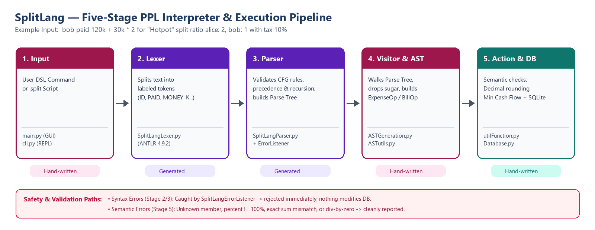

# SplitLang: A Custom Domain-Specific Language (DSL) for Deterministic Bill Splitting

**Course:** Principles of Programming Languages (Fall 2026)  
**School:** School of Computer Science and Engineering — VNU-HCM International University  
**Team ID:** `[Replace with your Team ID]`

---

## 1. Team Members & Contributions

| # | Full Name | Student ID | Role & Key Contributions |
|---|---|---|---|
| 1 | `[Member 1 Full Name]` | `[ITITIU...]` | Language & Grammar Design (`SplitLang.g4`), ANTLR 4.9.2 Lexer/Parser pipeline, Unit tests for Lexer/Parser |
| 2 | `[Member 2 Full Name]` | `[ITITIU...]` | Visitor & AST Generation (`ASTGeneration.py`, `ASTutils.py`), Semantic Analysis & Validation |
| 3 | `[Member 3 Full Name]` | `[ITITIU...]` | Financial Domain Engine (`utilFunction.py`: Decimal math, Largest-Remainder rounding, Min-Cash-Flow algorithm) & SQLite Database (`Database.py`) |
| 4 | `[Member 4 Full Name]` | `[ITITIU...]` | Desktop GUI with Live PPL Inspector (`main.py`), CLI Script Runner (`cli.py`), Demo scripts & Report |

*(Adjust rows to match your actual team size: 2 to 4 members.)*

---

## 2. Project Name

**SplitLang — A Custom Domain-Specific Language (DSL) for Deterministic Bill Splitting**

---

## 3. Problem Statement & System Description

Splitting shared expenses during group dinners, trips, or shared living is deceptively error-prone. Real-world receipts combine multiple split rules (equal splits, exclusions, exact amounts, percentages, weighted ratios), itemized dishes shared by different subsets of diners, layered modifiers (discounts, taxes, tips), and multi-person circular debts.

While general-purpose Large Language Models (LLMs) can parse free-form text, they are **non-deterministic**: they frequently miscalculate arithmetic, lose cents/VND during rounding, silently accept contradictory inputs (such as percentages summing to 95%), and require external cloud APIs.

**SplitLang** solves this problem by trading free-form ambiguity for **language-level reliability**:
- Users write concise, readable commands or multi-line scripts (`.split` files) such as:
  - `alice paid 120k + 30k * 4 for "Grab & Parking" split equally`
  - `bob paid 150k for coffee split exact alice: 60k, bob: 50k, charlie: 40k`
  - Block-structured itemized receipts (`bill "BBQ Night" paid by alice { item ...; tax 10%; tip 5% }`)
  - Queries and optimal settlements (`show balances`, `who owes whom?`, `settle up`)
- Every input is deterministically lexed, parsed, validated, evaluated using exact base-10 `Decimal` arithmetic, persisted locally in SQLite, and presented in a desktop GUI equipped with a live **PPL Inspector** (displaying Tokens, Parse Tree, and AST).

---

## 4. Framework & Workflow Architecture



```text
[1. Input]           Raw command / .split script (GUI main.py or CLI cli.py)
     |
     v
[2. Lexer]           SplitLangLexer.py (ANTLR 4.9.2) -> Labeled Token Stream
     |
     v
[3. Parser]          SplitLangParser.py + SplitLangErrorListener -> Parse Tree
     |               (If syntax error -> rejected immediately; nothing executes)
     v
[4. Visitor / AST]   ASTGeneration.py (SplitLangVisitor) -> Distilled AST Ops (ASTutils.py)
     |
     v
[5. Action / Engine] utilFunction.py (Semantic checks, Decimal rounding, Min Cash Flow)
                     + Database.py (SQLite persistence) -> Structured Dict -> GUI/CLI
```

---

## 5. Techniques Used per Component

| Component | File(s) | Core Technique |
|---|---|---|
| **Grammar & Parser Generator** | `parserAnalyzer/SplitLang.g4`, `run.py` | ANTLR 4.9.2 LL(\*) parser generator (`-Dlanguage=Python3 -visitor`) generating `SplitLangLexer`, `SplitLangParser`, `SplitLangVisitor`. |
| **Error Handling** | `controller/Response.py` | Custom `SplitLangErrorListener` overriding `syntaxError()` to intercept lexical/syntax errors with exact line and column diagnostics and halt execution safely. |
| **AST & Visitor** | `module/ASTGeneration.py`, `module/ASTutils.py` | Gang-of-Four **Visitor Pattern** subclassing `SplitLangVisitor`. Strips syntactic sugar (`for`, `,`, `{`, `}`, `?`) and produces typed Command AST nodes (`ExpenseOp`, `BillOp`, `SettleOp`, `QueryOp`, etc.). |
| **Financial Split Engine** | `module/utilFunction.py` | Base-10 `Decimal` arithmetic (zero IEEE-754 float drift) + **Largest-Remainder (Hamilton) Rounding** guaranteeing `sum(shares) == total` to the last VND/cent + **Greedy Minimum Cash Flow** algorithm reducing debt settlement to at most `N - 1` transfers. |
| **Persistence** | `module/Database.py` | Embedded relational **SQLite** database (`groups`, `members`, `expenses`, `expense_shares`, `settlements`, `action_log`) enabling zero-setup offline execution and `undo`/`reset`. |
| **User Interfaces** | `main.py`, `cli.py` | Tkinter dark-themed Desktop App with live Balances/Expenses dashboard + **PPL Inspector** (Tokens, Parse Tree, AST), plus an interactive CLI REPL and `.split` script runner. |

---

## 6. Application of Principles of Programming Languages (PPL) Concepts

1. **Lexical Analysis & Token Prioritization**: Keywords (`PAID`, `SPLIT`, `BILL`, `TAX`, `CURRENCY_CODE`) are declared before the fallback identifier rule `ID` so maximal-munch tokenization prioritizes keywords. Case-insensitive fragments (`fragment A: [aA];`) eliminate case-sensitivity fragility while preserving original casing inside `STRING` and `ID` tokens. Specialized numeric literals (`MONEY_K` for `300k`, `MONEY_M` for `1.5m`, `MONEY_USD` for `$25.50`, `PERCENT_LIT` for `10%`, `DATE`) are recognized directly at the lexical level, while comments (`//`, `#`) and horizontal whitespace are skipped.
2. **Context-Free Grammar (CFG) & Statement Separation**: `SplitLang.g4` formalizes seven statement categories (group/currency, member management, expenses, itemized bill blocks, settlements, queries, controls). Keeping `NEWLINE` as a grammatical token in `stmtSep : (SEMI | NEWLINE)+` prevents unquoted multi-word descriptions (`for bun bo hue`) from greedily consuming identifiers on the following line while allowing clean, semicolon-free multi-line scripts.
3. **Recursion in Grammar Rules**: Variable-length lists of members and split allocations are defined using classic CFG right-recursion:
   ```antlr
   personList     : person COMMA personList | person ;
   exactAllocList : exactAlloc COMMA exactAllocList | exactAlloc ;
   ```
   The Visitor mirrors this structure recursively (`visitPersonList`), cleanly collecting lists of arbitrary length.
4. **Operator Precedence & Associativity**: Expense amounts support full arithmetic expressions (`120k + 30k * 4`, `(100k + 50k) * 2`) via ordered left-recursive alternatives with labeled rules (`# MulDivExpr` above `# AddSubExpr`, plus `# ParenExpr`), guaranteeing `*` and `/` bind tighter than `+` and `-`.
5. **Block-Structured Syntax**: Itemized receipts use scoped curly-brace blocks (`bill "BBQ" paid by alice { item ...; tax 10%; tip 5% }`) parsed into nested `BillOp` AST nodes, where bill-level modifiers distribute proportionally across all item consumers.
6. **Syntax vs. Semantics Separation**: The ANTLR parser enforces grammatical structure, whereas `ASTGeneration.py` translates Parse Trees into distilled AST `Op` nodes and `utilFunction.py` enforces **semantic constraints** that CFGs cannot express (e.g., verifying members exist in the active group, percentages sum to exactly `100%`, exact shares match the bill total, and preventing division by zero).

---

## 7. Verification & Summary

SplitLang is verified by an automated `pytest` suite (`tests/test_lexer_parser.py`, `tests/test_ast_visitor.py`, `tests/test_domain_logic.py`) covering valid/invalid grammar cases, operator precedence, Parse Tree -> AST conversion, exact rounding across VND and USD, itemized bill proportionality, semantic error rejection, and minimum-transfer debt simplification.
